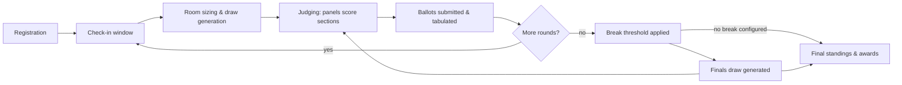

# Tournament Mechanics & the Rules Engine

This is the core of PS Tab: how a tournament actually runs, round by round, and the algorithms that make each step fair and repeatable. See [glossary.md](glossary.md) for term definitions (section/heat/room, panel, ballot, etc.).

## 1. Lifecycle overview

A tournament moves through the same shape every time, regardless of how many rounds or events it runs:



Each pass through "Judging → Tabulated" is one **round**. The loop back to check-in matters: PS Tab re-reads who is actually present before *every* round, not just once at the start — a tournament's live headcount is expected to shrink (scratches, no-shows) and the room plan should shrink with it rather than draw phantom speakers into empty rooms.

## 2. Roster ingestion & bulk onboarding

Organizers onboard three kinds of people, usually via CSV upload before the tournament opens:

- **Independent speakers** — competing without institutional affiliation.
- **Institution-affiliated speakers** — carry an institution tag used only for clash-spreading (§4), never for scoring.
- **Judges** — carry an institution tag (for the same clash purpose) and a role (chair-eligible or not, if the tournament distinguishes).

**Ingestion workflow:**

1. Organizer uploads a CSV (one for speakers, one for judges — kept separate since the required fields differ).
2. System validates row-by-row: required fields present, email format valid (used later for account claiming — see [04-identity-and-auth.md](04-identity-and-auth.md)), no duplicate emails within the same file.
3. Rows that fail validation are quarantined into a per-row error report (row number, field, reason) — the valid rows still import. Nothing blocks on a handful of bad rows; the organizer fixes and re-uploads just the failed rows.
4. Cross-file duplicate detection: an email already present as a speaker can also appear as a judge (some tournaments reuse alumni as judges) — this is allowed, flagged for visibility, not blocked.
5. On successful import, every person gets an internal roster entry and (later) a token-issuance record — see [04-identity-and-auth.md](04-identity-and-auth.md) — but no login is required at this stage.

Late additions (walk-in registrations, added judges) use the same single-row path as bulk import — same validation, same error reporting, no separate code path.

**Self-service registration.** Alongside organizer-driven bulk CSV import, a person can register themselves directly through a public form — the minimum viable submission is **email, name, and institution** (institution optional for independents). This is the same single-row ingestion path as a late addition (§ above): same validation, same duplicate handling, no separate code path — self-service registration is just another way a row enters the roster, not a different pipeline.

**Institution field — grow-by-selection, not free text.** There is no pre-seeded master list of institutions; the set of institutions simply grows as people register. To keep that growth from producing near-duplicate entries ("Lincoln High School" vs. "Lincoln HS" vs. "lincoln hs"), the institution field is never a plain text box: it's a searchable combobox that queries existing institutions first and only creates a new one if the person explicitly chooses "add new" after confirming no existing match fits. This applies identically whether the row comes in through the public self-service form or through an organizer manually adding a late entry — bulk CSV import is the one path that can't apply this UI-level nudge (a spreadsheet has no autocomplete), so CSV-imported institution names are matched fuzzily against the existing list at import time and flagged for organizer confirmation on anything below a high similarity threshold, rather than auto-created silently.

## 3. Check-in window & dynamic room sizing

Debate tab tools size rooms once, from registration counts, and assume the pairing algorithm resolves the rest. PS Tab can't do that: a section's fairness depends on *how many* speakers are actually in the room, so room count and size are recomputed **immediately before each round's draw**, from live check-in data, not from registration counts.

**Protocol:**

1. A check-in window opens a fixed lead time before the round (organizer-configured, e.g. 30 minutes).
2. Speakers and judges check in via their token link (tap a button) or are marked present by tab staff at a physical check-in desk.
3. At window close, the system reads the **active headcount** $N$ (checked-in speakers) and **active judge count** $J_{avail}$ for that round.
4. Room sizing is computed from $N$ against organizer-configured bounds $R_{\min}$ and $R_{\max}$ (typically $R_{\min}=4$, $R_{\max}=8$ for most speech formats).

**Room-count algorithm:**

```
function computeRoomPlan(N, R_min, R_max):
    if N < R_min:
        return single room of size N   # too few to split; flag for organizer review
    
    k_min = ceil(N / R_max)     # fewest rooms that keep every room <= R_max
    k_max = floor(N / R_min)    # most rooms that keep every room >= R_min
    
    if k_min > k_max:
        # no room count satisfies both bounds — widen R_max by 1 and retry,
        # rather than silently violating R_min
        return computeRoomPlan(N, R_min, R_max + 1)
    
    k = k_min                    # prefer fewest rooms (bigger, fuller sections)
                                  # organizers may instead configure "prefer smaller rooms" -> k = k_max
    base = floor(N / k)
    remainder = N mod k
    
    # distribute the remainder one-per-room so sizes differ by at most 1
    room_sizes = [base + 1] * remainder + [base] * (k - remainder)
    return room_sizes
```

**Worked example:** $N = 27$, $R_{\min}=4$, $R_{\max}=8$. $k_{\min} = \lceil 27/8 \rceil = 4$, $k_{\max} = \lfloor 27/4 \rfloor = 6$. Preferring fewest rooms, $k=4$: base $= 6$, remainder $= 3$ → room sizes `[7, 7, 7, 6]`. All four rooms are within [4,8] and differ by at most 1.

**Edge cases:**
- $N$ below $R_{\min}$ entirely (very small tournament or late-stage attrition): collapse to one room and flag it — organizer decides whether to run it anyway or merge with another event.
- Judge shortfall: room *count* is also capped by how many independent panels $J_{avail}$ can actually staff (see §7 panel-size rules and [02-judging-contingencies.md](02-judging-contingencies.md)) — if headcount math wants 4 rooms but only 3 panels exist, room count is reduced and sizes recomputed, never left judge-less.
- The plan is recomputed fresh each round; a room count that worked in Round 1 is not assumed to still fit in Round 3.

## 4. Rubrics & the score aggregation pipeline

### Rubric configuration

Organizers define one or more **rubric presets** per event type (e.g., a Prepared Speech rubric vs. an Impromptu rubric). Each preset is a list of criteria, each with a point cap, plus an optional **base score**: every speaker starts from the base, and the criteria are the *remaining* points allocated on top rather than the whole total. A rubric that doesn't use this convention just leaves the base at 0.

```
Rubric "Standard Prepared Speech":
  Base score: 70
  - Content      (0-10)
  - Delivery     (0-10)
  - Structure    (0-5)
  - Language Use (0-5)
  (max total: 70 + 30 = 100)
```

A rubric also carries the **time-penalty policy** for that event: allowed speech length, a grace period (e.g., ±10 seconds with no penalty), and a penalty schedule beyond grace (e.g., 1 point per 5 seconds over, capped at some maximum deduction).

### The pipeline

For a single speaker in a single round:

```
Judge Total (per judge) = BaseScore + Σ Score(criterion_i)  -  TimePenalty
                                        over all criteria in the rubric

Round Score = (1 / J) * Σ Judge Total_j         over all J judges on the panel

Rank = position of this speaker's Round Score when all Round Scores
       in the section are sorted descending
```

- **Time penalty** is computed once per judge (each judge times independently, or the system uses a single authoritative stopwatch reading shared across the panel — a tournament-level configuration choice) and subtracted before the judge's criteria are summed, so a harsh timer and a generous scorer don't need separate treatment downstream.
- **Rank conversion happens per section, per round** — ranks are never compared across sections directly (a 1st in a 6-person room and a 1st in an 8-person room are the same "1" for standings purposes; see §6).
- **Ties in Round Score within a section**: whether ties are even possible at all is a per-round-stage setting, not left to chance — see §7's "Tie permissiveness" for the full rule (short version: prelims can allow them, outrounds never do).

### Ballot mode: Democracy vs. Strict

The formula above assumes each panelist scores independently and the panel's scores get averaged — that's **Democracy** mode, and it's the default. Some tournaments instead run **Strict** mode: the whole panel (chair and panelists together) deliberates in the room and submits **one single ballot** for the section, not one per judge.

- In Strict mode, the "Round Score" *is* that one submitted Judge Total — there's no averaging step, because there's only ever one ballot to average. This is the same degenerate case the pipeline already handles for a genuinely single-judge panel (see §14); Strict mode is just a deliberate, chosen version of that rather than an accident of judge availability.
- The single ballot is conventionally submitted by the **chair**, on behalf of the panel's deliberation — this is exactly what a chair's tie-break/deliberation authority (see [glossary.md](glossary.md)) is *for*.
- This is an organizer setting (**Democracy** or **Strict**), defaulted at the division level, with the same point-in-time override capability as break configuration (§8) — a specific round can run Strict even if the division default is Democracy, or vice versa, decided at the moment that round is set up rather than locked in from the start of the tournament.

## 5. Section allocation & institutional spreading

Once room sizes are known (§3), speakers must be assigned to specific rooms. The goal is to **minimize same-institution pairings within a room** — ideally to zero, but not at the cost of leaving rooms unfillable.

**Constraint model:**
- **Hard constraint:** every speaker assigned exactly once; room sizes match the plan from §3.
- **Soft constraint (penalized, not forbidden):** two speakers from the same institution in the same room. Each such pairing adds a clash-penalty weight to that draw's total score.

**Heuristic (greedy + local repair):**

```
function allocateSections(speakers, room_sizes):
    rooms = create empty rooms per room_sizes
    sort speakers by institution group size, descending
        (place the most "clash-risky" institutions first, when rooms are most open)
    
    for speaker in sorted speakers:
        candidate_rooms = rooms with available capacity
        pick the room minimizing marginal clash penalty
            (fewest existing same-institution speakers already placed there)
        assign speaker to that room

    # local repair pass: try pairwise swaps between any two rooms;
    # accept a swap if it strictly reduces total clash penalty
    repeat until no improving swap found or max iterations reached:
        for each pair of speakers in different rooms:
            if swapping reduces total clash penalty:
                swap them

    return rooms
```

This is intentionally a lightweight greedy-plus-local-search approach rather than an exact solver: tournament draws must generate in seconds for a live event, and near-optimal spreading is sufficient — a formal CSP/ILP solver is unnecessary overhead for room counts in the tens, not thousands.

**When clash-free is impossible** (e.g., one institution sends 5 speakers into 4-person rooms with only 4 rooms total, and every room would need to take at least one from that institution twice): the algorithm still terminates with the *lowest achievable* total penalty and **flags every room where a clash remains**, visibly, in the organizer draw view — never silently.

Institutional spreading is computed once, before speaking-order assignment — order is a purely within-room concern layered on top (§6).

## 6. Speaking-order position-bias balancing

Speaking first or second in a section is a documented disadvantage in speech formats — early speakers get compared against a field the judge hasn't fully calibrated to yet. Left unmanaged, the same unlucky speakers could draw an early slot every round. PS Tab tracks this explicitly and corrects for it.

**Tracking:** for every speaker, the system keeps a running history of the position they drew in every prior round of the tournament (e.g., speaker X drew positions `[1, 3, 2]` across rounds 1–3).

**Bias penalty function:** before assigning positions for the upcoming round, each speaker in a room gets a bias score reflecting how "front-loaded" their history is — a simple, transparent formulation:

```
BiasScore(speaker) = Σ weight(position_r) for r in speaker's round history

where weight(position) is higher for earlier positions, e.g.:
  weight(1) = 3, weight(2) = 2, weight(3) = 1, weight(4+) = 0
```

**Assignment within a room:**

```
function assignSpeakingOrder(room_speakers):
    sort room_speakers by BiasScore descending
        (speakers who have drawn early slots most often go first in this sort)
    assign the *last* available position to the top of that sorted list,
        working backward, so high-bias-score speakers get later slots this round
    return position assignments
```

In effect: whoever has been disadvantaged the most so far gets pushed toward the back of the room this round, and the running history updates immediately so the next round's computation reflects it. Over a multi-round tournament this converges toward every speaker having a roughly even spread of early/late slots, without ever hard-coding "you must speak in position N" (which would conflict with room assignment and clash-spreading, computed independently in §5).

**Interaction with room assignment:** which room a speaker lands in is decided first (§5, driven by clash-spreading); speaking order within that already-decided room is the second, independent pass described here. The two concerns don't compete for the same decision.

## 7. Tabulation & tie-breaking hierarchy

Cumulative standings are the aggregate across all completed rounds, ranked using a strict priority matrix — each tier is only consulted to break ties in the tier above it:

```
1. Total Ranks       — sum of a speaker's rank across all rounds (lower is better)
2. Total Speaker Points — sum of Round Score across all rounds (higher is better)
3. Adjusted Ranks    — Total Ranks recomputed after dropping each speaker's single
                       worst round (protects against one bad room/panel draw)
```

**Worked example:** Speakers A and B both have Total Ranks = 6 after 3 rounds (e.g., A: 1st+2nd+3rd, B: 2nd+2nd+2nd). Tier 1 ties. Move to Tier 2: compare Total Speaker Points — whoever accumulated more raw score across the tournament ranks higher. If *that* also ties (rare but possible), Tier 3 recomputes Total Ranks with each speaker's single worst round dropped, and compares again.

This hierarchy is configurable in principle (some circuits weight speaker points above ranks), but the above is the recommended default and the one described throughout this docset.

### Tie permissiveness: prelims vs. outrounds

A tied Round Score within a section (§4) is handled differently depending on the stage:

- **Preliminary rounds** may allow ties — an organizer setting (default: allowed). When allowed, tied speakers share a fractional average rank (e.g., two speakers tied for 1st both receive rank 1.5, per the standard "competition ranking" convention). When disabled, prelim ranks are forced sequential the same way outrounds always are (below), using a configured tie-break criterion (commonly: highest Content sub-score, or chair decision) to separate them.
- **Outrounds never allow ties, full stop** — this is not an organizer setting. Every outround rank must be sequential, because an outround rank directly determines who advances; an unresolved tie there is a live problem needing an immediate tie-break decision (typically the chair), not a shared rank.

## 8. Break & finals generation

**Threshold configuration:** organizers set a break rule before the final preliminary round, typically one of:
- **Fixed count** — "break top 6" (or top N per category, e.g., novice/open run separately).
- **Percentage** — "break top 25% of the active field."
- **Points/rank floor** — "break everyone at or better than rank X on cumulative standings," which can break more or fewer than a fixed count if there's a tie at the cutoff (ties at the break line are typically *all* broken in, rather than coin-flipped, to avoid controversy — this is an organizer-configurable choice with the "include ties" default).

This threshold is a tournament/division **default**, set ahead of time — but it isn't locked in. Tab staff can override it for one specific stage at the moment that stage is actually broken (a field ran larger or smaller than expected, or a partial break's per-room auto-advance count needs adjusting on the day) without touching the configured default for every other stage. Like any other manual override (docs/05), this is audit-logged with who changed it and why, not a silent one-off edit to tournament settings.

**Generation:** once the cutoff is applied to final preliminary standings, the qualifying speakers become the finals roster. Finals draws are generated by **re-running the same two engines** already defined:
- Section allocation (§5) — reapplied if finals split into multiple rooms (some formats run one single finals room instead; in that case §5 is a no-op).
- Speaking-order balancing (§6) — reapplied using each speaker's *entire* preliminary-round history, so a speaker who spoke early all prelims doesn't also get stuck early in finals.

No separate "finals algorithm" exists — finals is a draw like any other round, just seeded from the break list instead of a fresh check-in headcount (though check-in of the qualified speakers still happens, per §3, since attrition can happen even at this stage).

**Partial breaks.** Not every outround breaks cleanly on aggregate standings the way prelims-to-finals does. A common alternative: the top few finishers *in each room* of an outround advance automatically (e.g., the top 2 from every room, having already "broken" outright), while the remaining eligible finishers in each room (e.g., 3rd through 6th place) don't advance automatically *or* get eliminated — instead, that whole pool competes against each other in one additional **bubble round**, scored exactly like any other round (§4). Whoever places highest in the bubble round fills whatever slots remain in the next stage's roster, joining the automatic advancers. This is still "no new algorithm per stage" in spirit (§11) — the bubble round uses the identical scoring pipeline (§4) and tabulation (§7) as any other round; the only genuinely new piece is the per-room split between "advanced automatically" and "must win the bubble round to continue," and the subsequent merge of both groups into one roster for the next stage.

**Multiple break categories** (e.g., Novice break and Open break run as separate finals) are handled as fully independent instances of this same pipeline — separate rosters, separate rooms, separate standings, no shared state between them except the originating preliminary rounds.

## 9. Divisions & eligibility

Many tournaments run **experience-based divisions** in parallel (commonly Novice vs. Open/Varsity) rather than one undifferentiated field.

- **Assignment:** a speaker's division is set at registration — either self-declared or organizer-assigned from an eligibility rule (e.g., "no more than 2 years of competitive experience" or "no prior tournament wins qualifies as Novice"). This is a roster attribute, checked at ingestion (§2), not something computed by the rules engine.
- **Operational effect:** everything from §3 onward — room sizing, section allocation, position-bias tracking, tabulation, breaks — runs **independently per division**. A Novice room is never mixed with an Open room, and a Novice speaker's position-bias history never interacts with an Open speaker's, even if they happen to compete in overlapping time slots.
- **Division changes mid-tournament** (a speaker discovered to be mis-declared) are a manual, audit-logged roster correction, not an automatic reclassification — reclassifying someone after they've already banked results in one division is a judgment call for tab staff, not the algorithm.
- **Cross-division awards** (e.g., an overall "Best Speaker" award spanning both divisions) are a separate, optional aggregation computed after each division's own standings are final — it never feeds back into either division's own tab.

## 10. Multi-event scheduling collisions

Tournaments commonly run several events concurrently (e.g., Extemporaneous, Oratory, and Duo Interpretation all running their own rounds at the same time blocks), and the same person can be entered in more than one.

- **Speaker double-booking:** before a draw is generated, the system checks every speaker's other event assignments for the same time slot. A speaker who is scheduled to compete in Event A's Round 2 at the same time as Event B's Round 2 is flagged **before** the draw locks, not discovered after rooms are posted — tab staff resolve it by staggering that speaker's round (running one event's round slightly offset) or, if unavoidable, by scratching the speaker from one event for that round (§14, treated as a late scratch).
- **Judge double-booking:** the same check applies to judges pulled from a shared cross-event pool — a judge assigned to Event A's panel at a time slot can't simultaneously be drawn into Event B's reserve deployment (§[02-judging-contingencies.md](02-judging-contingencies.md)) for an overlapping slot. The judge pool's availability is scoped per time-slot across *all* concurrently-running events at that tournament, not per-event in isolation.
- **Shared room/venue capacity:** room sizing (§3) is computed per-event, but the room-count cap (driven by available judge panels) is drawn from a tournament-wide judge pool shared across concurrent events — sizing one event's rooms without accounting for what the other concurrent events are already drawing from the same pool would overcommit judges that don't exist.

## 11. Draw methods: random vs. power-matched, and multi-stage elimination

Section allocation (§5) as described is a **random draw** with clash-avoidance — appropriate for preliminary rounds where no performance data yet exists to pair on. Two additional configurable draw methods extend the same engine for later stages:

- **Power-matched pairing:** after one or more preliminary rounds, rooms can instead be seeded by current cumulative standings (§7) rather than randomly — e.g., "high-high" (top-ranked speakers grouped together, testing the strongest field against itself) or "high-low" (spreading strength evenly across rooms). This changes only the *seeding order* fed into the allocation heuristic in §5 — clash-avoidance and the greedy-plus-local-repair algorithm run identically; only the order in which speakers are placed into rooms changes from "sorted by institution risk" to "sorted by current standing, then institution risk as the tie-break within same-standing bands." Room *sizing* (§3) never changes based on draw method — power-matching only reorders who goes into the already-standardized rooms, it never resizes or recounts them.
  - This is a **Division-level default** (random vs. power-matched) with the same point-in-time override capability described in §8 for break configuration — an individual Round can flip a specific stage to the other method without changing the Division default for every other round. If a tournament's organizer setting is power-matched, that standing-based seeding order becomes one of the weights the room-allocation heuristic uses when generating rooms for that round; if random, allocation falls back to the plain clash-avoiding random draw described in §5. "high-low" is the conventional default *style* once power-matched is chosen, since it spreads strength evenly rather than stacking the field's best entrants into a single early-elimination room.
- **Multi-stage elimination:** rather than a single break-to-finals (§8), a tournament can configure a bracket of successive elimination stages (e.g., Break to Octofinals → Quarterfinals → Semifinals → Finals), each stage re-applying the break threshold to just the previous stage's results and re-running the same allocation + position-bias engines (§5–6) on the surviving field. No new algorithm is needed per stage — each stage is simply another instance of §8's pipeline, chained: this round's "break list" is the next stage's roster. Any individual stage in that chain can independently be a normal aggregate break *or* a partial break (§8) — a tournament might, for example, run Octofinals as a partial break (top 2 per room plus a bubble round) but Quarterfinals and Semifinals as ordinary breaks.
- Both are organizer-configured per tournament (or per division, §9) before rounds begin; a tournament can mix them — random prelims, power-matched final prelim round, single-elimination bracket to finals — without any of the three engines needing to know about the others' configuration.

## 12. Institutional sweepstakes & team scoring

Beyond individual speaker standings (§7), organizers can enable an **institutional aggregate score** — a parallel leaderboard representing how an entire school/club performed as a group, independent of any individual's placement.

- **Aggregation rule** is organizer-configured, typically one of: sum of an institution's top-K speakers' cumulative points, or a fixed points-per-placement-bracket scale summed across every entrant from that institution (so a school's overall showing counts even from speakers who didn't personally break).
- Sweepstakes is a **read-only derived view** — it never feeds back into any individual speaker's rank, points, or break eligibility (§7–8). It exists purely as its own award category.
- Cross-tournament (season-long) institutional standings are a separate, circuit-level extension of this same concept — see [08-cross-tournament-ecosystem.md](08-cross-tournament-ecosystem.md) §3.

## 13. Waitlists & registration caps

Organizers may cap registration per event or per institution (e.g., "max 6 entries per school in Extemp") to manage room-count feasibility (§3) ahead of time.

- Registrations beyond a configured cap are placed on a **waitlist** rather than rejected outright, in submission order.
- Waitlist promotion happens automatically as capacity frees up (a scratch, a cap increase by the organizer) — the next waitlisted entry is promoted and notified, in order, without staff needing to manually track the queue.
- A cap is a **soft ceiling** the organizer can override per-entry (e.g., admitting a late entry above the nominal cap) — the system warns when an override exceeds the configured cap but never blocks it, since the cap exists to manage expected load, not to be an inviolable hard rule.

## 14. Edge cases

- **Byes:** if headcount produces a room below $R_{\min}$ that can't reasonably merge (e.g., a single small event running in isolation), the round proceeds with that undersized room and it's flagged in the organizer view — never silently dropped from standings.
- **Uneven rooms:** always resolved by the ±1 remainder distribution in §3 — no room is ever more than one speaker larger than another in the same round.
- **Single-judge panels:** the Round Score pipeline (§4) degenerates gracefully — $J=1$ just means Round Score equals that one Judge Total. No special-casing needed in the formula, though see [02-judging-contingencies.md](02-judging-contingencies.md) for *why* a panel might end up at one judge and what organizer controls exist to prevent it happening by default.
- **Late scratches after a draw is posted:** handled as a targeted re-draw of only the affected room(s), not a full tournament re-draw — see [07-architecture-and-resilience.md](07-architecture-and-resilience.md) for the ripple-effect handling.
- **A speaker double-entered in two concurrent events:** treated as two independent roster entries tied to the same person/account; check-in, rooms, and standings are computed per-event with no cross-event interaction beyond the scheduling-collision check in §10 (this is the only sense in which PS Tab has an "iron man" concept — see [glossary.md](glossary.md)).
- **A division with too few entrants to meaningfully break:** if a division's field is smaller than its own configured break count (e.g., "break top 6" but only 4 Novice speakers registered), the break threshold clamps to the field size and the organizer is flagged rather than the system attempting to break more speakers than exist.
- **Waitlist promotion after check-in has already closed:** a promoted speaker who missed the check-in window (§3) for that round is simply treated as not-checked-in for that round like anyone else — waitlist promotion doesn't create a bypass around the standard check-in/headcount protocol.
