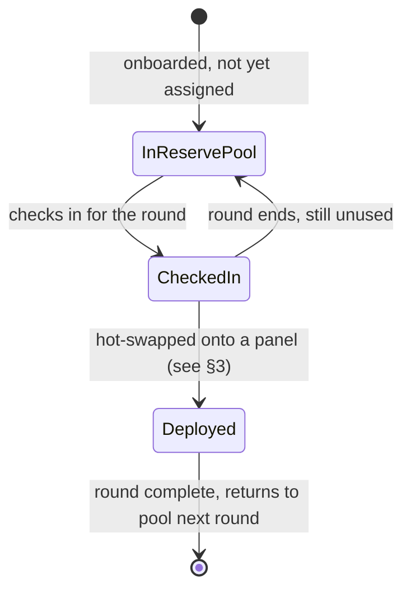
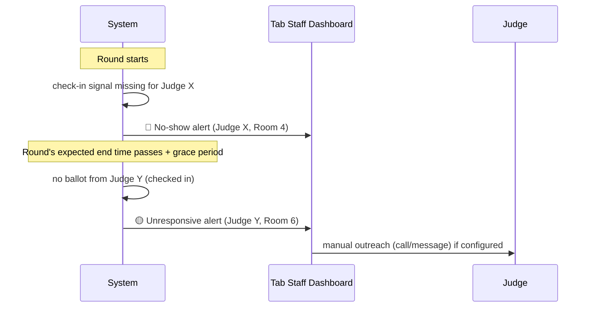

# Judge Contingencies, Swing Judges & Emergency Fallbacks

Panels don't always show up intact. This document covers how PS Tab keeps rounds running when judges are late, absent, conflicted, or simply run out.

## 1. The reserve / swing pool

Every tournament maintains a pool of judges who are **not** pre-assigned to a specific panel for the round — the reserve (or "swing") pool. Reserve judges are onboarded exactly like panel judges (§2 of [01-tournament-mechanics.md](01-tournament-mechanics.md)) but flagged as floaters rather than committed to a room.

**Lifecycle of a reserve judge:**

Reserves check in through the same window as panel judges (§3 of [01-tournament-mechanics.md](01-tournament-mechanics.md)) so tab staff know, before the round starts, exactly how many bodies are available to cover a gap — this number directly feeds the room-count cap described there (room count can't exceed what the *committed + reserve* judge pool can staff).

Organizers can size the reserve pool deliberately — e.g., "always hold back 2 judges per round" — trading a slightly smaller room count for a safety margin, or run with zero reserves and accept degraded-panel risk (§4).

## 2. No-show detection & alerts

Tab staff shouldn't have to notice a gap by wandering the halls. The system watches two signals per assigned judge, per round:

- **Check-in signal:** did the judge check in before the window closed? A judge who never checks in is flagged **at round start**, before speakers even enter the room — the earliest possible catch.
- **Ballot signal:** for a judge who *did* check in, is a ballot submitted within a configurable grace period after the round's expected end time (e.g., 15 minutes past scheduled end)? A judge present but not submitting is flagged as **unresponsive**, distinct from a no-show, since the room may just be running long.

**Escalation:**

Alerts surface directly in the organizer control center (see [06-ux-and-views.md](06-ux-and-views.md)) as a live-updating list, not a buried log — a no-show is a stop-the-room-drifting problem, so it's designed to be impossible to miss during an active round.

## 3. Instant hot-swapping

When staff need to replace a judge — no-show, sudden illness, discovered conflict — the swap is a single guided action, not a manual re-draw:

1. Staff selects the affected panel slot in the override UI.
2. System presents only **checked-in, currently-idle reserve judges** as candidates (already-deployed judges aren't offered, to avoid double-booking).
3. For each candidate, the system automatically re-runs the institutional-conflict check (same clash logic as §5 of [01-tournament-mechanics.md](01-tournament-mechanics.md), applied here between judge and the speakers/institutions already in that room) and surfaces a warning inline — staff can still override a warned pick if it's the only option, but never silently.
4. On confirm: the reserve is marked `Deployed`, the outgoing judge's status is set to whatever's accurate (`No-Show`, `Removed-for-Conflict`, etc.), and the swap is written to the audit trail (see [05-publishing-and-state.md](05-publishing-and-state.md)) with who performed it, when, and why.
5. If the round hasn't started scoring yet, the new judge simply picks up the assignment. If ballots are already partially entered by the remaining panel, the swap doesn't discard them — the incoming judge scores independently and the aggregation pipeline (§4 of [01-tournament-mechanics.md](01-tournament-mechanics.md)) just runs over whichever judges' totals exist for that room.

## 4. Degraded panel fallbacks

Sometimes there's no clean swap available — the reserve pool is empty, or every remaining reserve is conflicted. PS Tab defines an explicit, visible degradation path rather than blocking the round:

- **Collapse panel size:** if a panel configured for 3 judges is down to 2 (or 2 down to 1), the round proceeds with the smaller panel. The scoring pipeline handles this natively — Round Score is just the mean over however many Judge Totals exist (§4, [01-tournament-mechanics.md](01-tournament-mechanics.md)) — but every room that ran below its configured panel size is **flagged in standings and in the public results view** so nobody mistakes it for a full-strength panel silently.
- **Minimum panel enforcement:** organizers set an absolute floor (commonly 1 judge). If a room would drop *below* that floor — zero judges available — the round for that room cannot proceed; tab staff must either merge that room's speakers into another room's panel (re-running §5 allocation for just those speakers) or delay that room's start until a judge is freed up. This is the one case that blocks rather than degrades, because a room with zero judges produces no ballot at all.
- **Partial ballots:** if a judge starts scoring and has to leave mid-round (medical emergency, etc.) without finishing every speaker, their partial ballot is preserved per-speaker rather than discarded wholesale — Round Score for the speakers that judge *did* score includes that Judge Total; for speakers they didn't reach, that judge is simply excluded from the panel average for those speakers only. This is flagged the same way as a collapsed panel, since it produces an uneven $J$ across speakers within the same room — a case worth surfacing to tab staff explicitly rather than assuming it's a data error.

The unifying principle: **degrade visibly, never silently, and never invent a score**. A missing judge shrinks the panel average's denominator; it never gets backfilled with an assumed or imputed number.

## 5. Preventing shortfalls before they happen

Sections 1–4 cover reacting to a gap. Just as important is reducing how often a gap occurs in the first place:

- **Judge fatigue caps:** organizers can configure a maximum rounds-per-day (or a required rest round) per judge. A judge already at their cap is excluded from the assignment pool for further rounds that day automatically — the same "unavailable for assignment" state a checked-out reserve would have — rather than relying on staff to remember who's been judging back-to-back.
- **Self-reported recusal:** a judge who knows of a conflict (coaches a speaker in the upcoming round, personal relationship, etc.) can flag it themselves *before* assignment, through their own check-in flow — this runs through the identical institutional-conflict machinery used for automatic detection (§5, [01-tournament-mechanics.md](01-tournament-mechanics.md)), just triggered by the judge instead of the system. A self-recusal pulls that judge out of the pool for that round and returns them to the reserve pool for subsequent rounds, same as any other unassigned-for-this-round state.
- **Live scoring calibration:** during the tournament (not just in the post-hoc reliability metrics of [04-identity-and-auth.md](04-identity-and-auth.md)), the system flags a submitted ballot whose speaker-by-speaker ranking diverges sharply from the rest of the panel's ranking for the same room — surfaced to tab staff as a review prompt, not an automatic score change. This catches data-entry errors and severe outlier judging early enough to address before a round locks, rather than discovering it only in a season-end reliability report.
