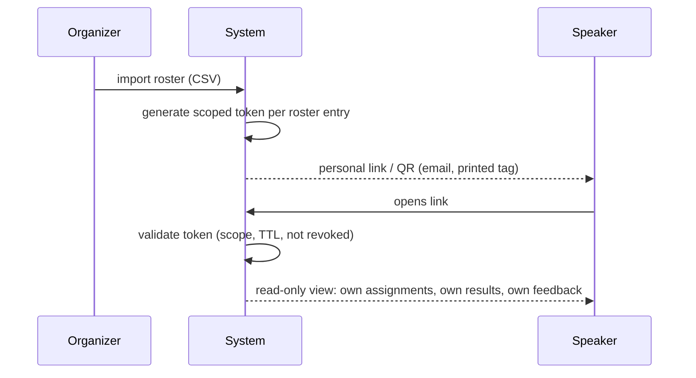

# Identity, Authentication & Zero-Auth Access

Tournament day and a competitor's multi-year career have opposite access needs: one needs zero friction for a few hours, the other needs a durable identity across dozens of unrelated events. PS Tab treats these as two layers, not one compromise — a lightweight tokenized layer for live-event access, and an optional authenticated layer on top for anyone who wants persistence.

## 1. Zero-auth tokenized access (live tournament UX)

Every roster entry (speaker or judge) gets a personal access token the moment they're imported (§2, [01-tournament-mechanics.md](01-tournament-mechanics.md)) — no signup, no password, nothing for the person to do before it exists.

**What the token grants:** read-only access scoped to exactly that one person — their own assignments, their own ballots/feedback once published to them, their own check-in action. It never exposes a list of other competitors' private data, even though the same person can *also* see the public portal's published draws/standings like anyone else.

**Delivery:** the token is embedded in a unique personal URL, and the same URL is renderable as a QR code — organizers can email the link, print a QR code on a name tag, or both. Either form resolves to the identical scoped session.

**Design of the token itself:**
- High-entropy, unguessable, and unrelated to the person's email or name (no PII embedded in the URL/token string itself) — knowing someone's name or which tournament they're in gives no path to guessing their token.
- Carries an explicit **scope** (which tournament, which person, read-only vs. check-in-capable) and a **TTL** — tokens expire automatically at a sensible boundary (e.g., some window after the tournament concludes), rather than staying valid forever by default.
- **Organizer revocation**: staff can invalidate a specific token instantly (lost phone, token accidentally shared/screenshotted) and reissue a fresh one to the same roster entry — the old one stops working the moment revocation is confirmed, no propagation delay.
- **Replay/reuse is fine, interception is the risk to design against** — since it's a bearer credential, the mitigations are TTL, scope narrowness, and revocability rather than one-time-use, since a person legitimately reopens their own link many times across a multi-day tournament.

**Flow:**

## 2. Authenticated profiles & cross-tournament aggregation

For people who compete or judge repeatedly, a token-per-event model loses everything at the TTL boundary. An optional, persistent **account** layer sits above the token layer for exactly this case.

**Roster-to-account matching:** the system links a roster entry to a persistent account one of two ways:
- **Email match** — if the roster entry's email matches an existing account's verified email, the tournament's results attach to that account automatically once claimed (never silently — the person still confirms the link, see below).
- **Manual claim code** — for cases where email doesn't match (a different address used for this tournament, a first-time account), the organizer or system issues a short claim code the person enters from their account settings to attach this tournament's roster entry to themselves.

Claiming is always **person-initiated and confirmable**, never automatic-and-invisible — a mismatched auto-link would misattribute someone else's competitive record, which is a correctness problem serious enough to require an explicit confirmation step.

**What an account aggregates once tournaments are claimed:**
- Cumulative competitive stats across every claimed tournament (career win/rank history, not just one event's).
- A historical feedback archive — every judge comment and score breakdown the person has ever received, searchable across events rather than scattered across one-off tournament logins.
- For judges specifically: **judge reliability metrics** over time — e.g., how often their scores fall in line with panel consensus, how consistently they submit ballots on time — visible to the judge themselves and to tab staff evaluating who to invite/rely on for future events (not exposed publicly, since it's a staffing signal, not a competitive one).

**Upgrade path:** a person can start purely on the zero-auth token (tournament day, no account) and later create an account and claim that same tournament's results retroactively — the token access was never a dead end, just a starting point that persists if they choose to formalize it.

## 3. How the two layers interact

| | Zero-auth token | Authenticated account |
|---|---|---|
| Setup required | None — issued automatically on roster import | Signup + claim per tournament |
| Scope | One tournament, one person | Every claimed tournament |
| Lifetime | TTL-bound, organizer-revocable | Persistent, user-owned |
| Typical use | Tournament-day access on someone's phone | Season-long / career tracking |

A tournament never *requires* an account to function — every capability described in [01-tournament-mechanics.md](01-tournament-mechanics.md) through [03-roles-and-access.md](03-roles-and-access.md) works entirely on tokens. Accounts are additive, not a gate.

## 4. Account recovery

Losing access to an *authenticated account* (forgotten credential, lost second factor if configured) is a distinct problem from losing a tournament-day token (§1) — a token is scoped and organizer-recoverable in minutes; an account is the durable identity a whole career is attached to, so recovery is deliberately a bit more rigorous:

- Standard email-based recovery (a reset link to the account's verified email) is the default path — no different from most account systems, and sufficient for the vast majority of cases since the account's verified email is exactly what claiming (§2) already anchors on.
- If the recovery email itself is inaccessible (address abandoned, account predates a compromised inbox), recovery falls back to **support-mediated verification** — a Super Admin–adjacent support flow, not a self-serve one, since bypassing the email anchor is exactly the kind of action that needs a human check rather than an automated one.
- Recovering account access never re-triggers claim confirmation for tournaments already claimed — recovery restores access to the existing account and its history as-is; it is not a re-claim of anything.

## 5. Identity integrity, minors, and data rights

Three concerns that only bite once accounts start aggregating a real career's worth of history — **disambiguating and merging profiles**, **guardian consent for minors**, and **data deletion/retention rights** — are covered in depth in [08-cross-tournament-ecosystem.md](08-cross-tournament-ecosystem.md) §4–5, since they're fundamentally about the integrity of cross-tournament aggregation rather than the auth mechanism itself. The short version: claiming is always email/claim-code anchored (never name-based, so collisions can't misattribute a result), duplicate accounts can be explicitly merged, minors need guardian consent to move beyond token-only access, and any account holder can request deletion of their aggregated profile without erasing the underlying tournament's own historical record.
