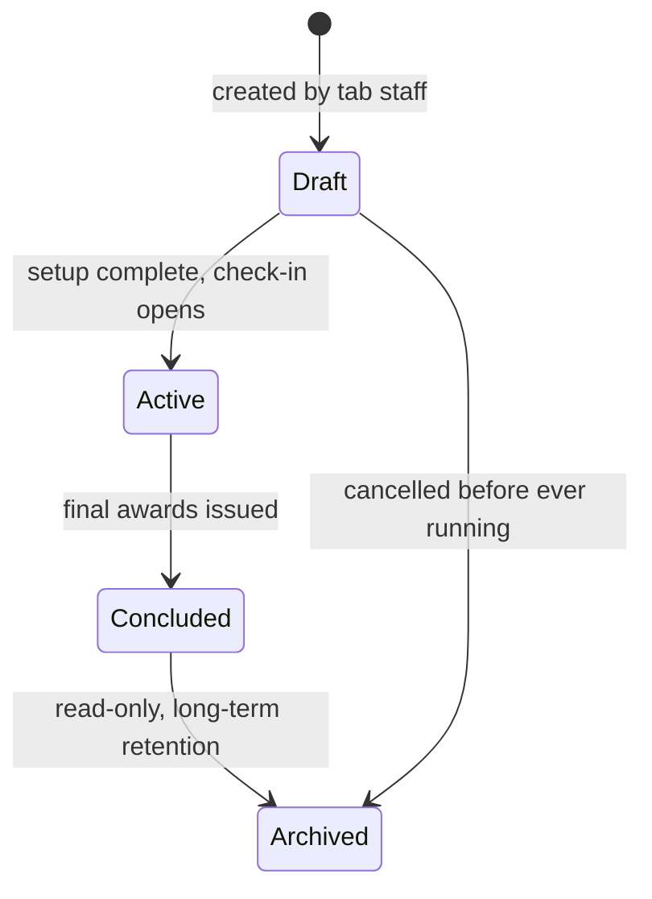
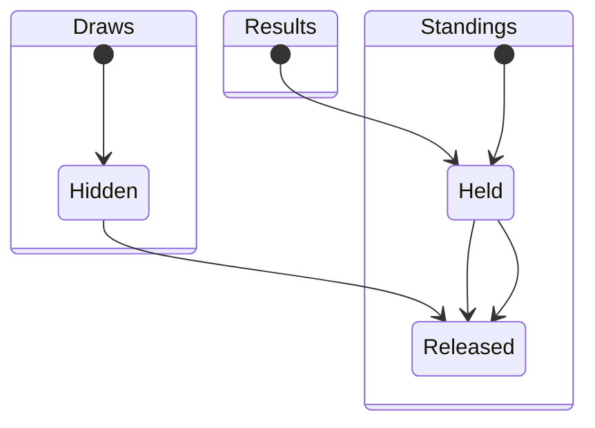
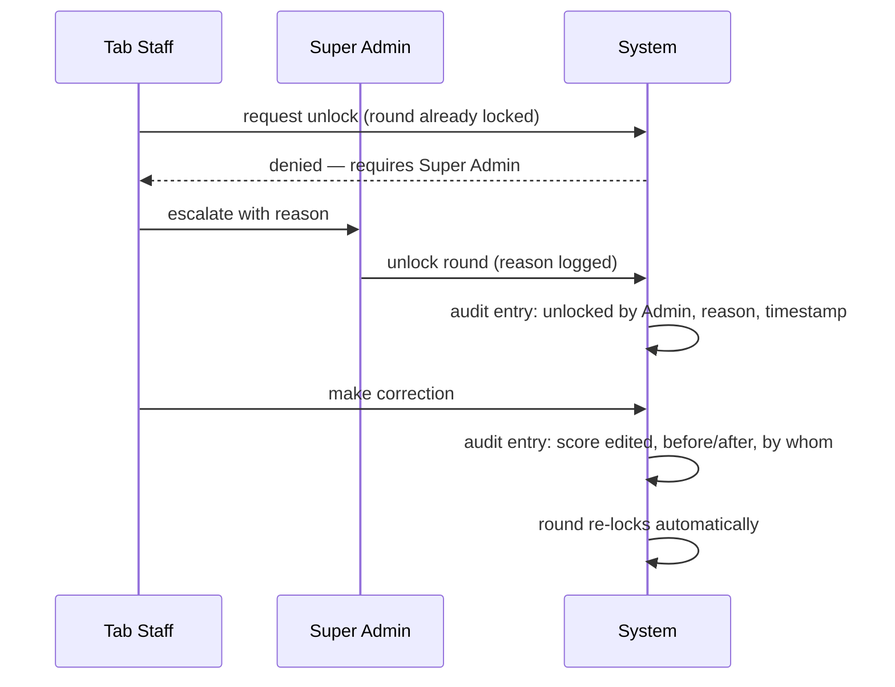

# State-Driven Publishing & Visibility Control

Nothing in PS Tab becomes visible to competitors or the public by default — every release is a deliberate organizer action. This document defines the state machines that control that, and the audit trail that makes every state transition accountable.

## 1. Tournament-level states

A tournament as a whole moves through a small set of states that gate its very existence to the outside world:

- **Draft** — exists only to tab staff; rubrics, room bounds, and break rules are configured here. Never visible to the public or listed on any public tournament index.
- **Active** — the tournament is running; round-level gates (§2) govern what's visible during this state.
- **Concluded** — all rounds finished, final standings and awards issued. Still editable only by Super Admin escalation (see §3).
- **Archived** — permanently read-only. Useful for long-term public reference and for authenticated profile aggregation (§[04-identity-and-auth.md](04-identity-and-auth.md)) without risk of the historical record shifting under someone.

**Global feedback-window control:** independent of the state machine above, organizers set a window during which competitors must submit any required post-round evaluations (§[06-ux-and-views.md](06-ux-and-views.md)) — e.g., open from round-end until 48 hours after the tournament concludes. This is a simple timestamp gate, not a state, but it's tournament-global by design so it doesn't need per-round configuration.

## 2. Round-level lifecycle states

Within an Active tournament, **each round** carries three independent visibility gates — draws, results, and standings don't have to release together, and typically shouldn't:

- **Draws: Hidden → Released** — releasing this publishes room assignments and judge panels for the round, so competitors know where to go. Typically flipped right after generation, well before judging starts.
- **Results: Held → Released** — releasing this publishes that round's ballots (ranks, scores, comments) to the relevant competitors and, if configured, publicly. Usually held until *all* rooms in the round have submitted and been tabulated, so no competitor sees their own result while others are still mid-round.
- **Standings: Held → Released** — releasing this pushes the *cumulative* leaderboard live. Some tournaments intentionally hold this back across multiple rounds (a "blind" tournament format) even while releasing individual round results, to avoid a runaway leaderboard effect influencing behavior mid-tournament — this is exactly why the three gates are independent rather than one combined toggle.

**Computation respects release state, not just display.** A held round's ballots already exist in the database — tabulation doesn't wait for a publish click — but any cumulative figure derived from them (running standings, a speaker's aggregate rank, judge-feedback averages feeding a judge break) must only ever be computed, for a competitor- or public-facing view, from rounds whose Results gate has actually released. A round that's tabulated-but-held contributes nothing to what any competitor or the public can see, even indirectly through a total that quietly folds in its numbers — the same "never leak an unreleased value through a downstream computation" rule applies whether that value is a single ballot or a whole round's contribution to a multi-round total. Two cases fall on either side of this line intentionally:
  - **Internal-only uses stay internal.** Power-matched seeding (§11, [01-tournament-mechanics.md](01-tournament-mechanics.md)) needs the *current* standing to seed the next round's rooms, including standings drawn from a round tab staff haven't released yet — that's a system computation feeding a draw, never a value shown to a competitor, so it's exempt from the release gate the same way an unpublished draft is exempt from the public tournament index (§1).
  - **Any competitor- or public-facing surface stays gated.** If a "your current standing" view would need to include a held round's contribution to be accurate, it instead reflects the standing as of the last *released* round's results — never a version that's silently more current than what's actually been published — until that round's own Results (and, separately, Standings) gate flips.

Each gate is, by default, a simple staff-triggered switch — a round's results stay held indefinitely if staff simply never flip it, which is itself sometimes the intended behavior (e.g., holding results for a disputed round pending review). Organizers who want a hands-off release can instead **schedule** a gate to flip automatically at a future timestamp (e.g., "release Round 2 standings at 5:00pm") — this is an explicit opt-in per gate, not a default behavior, and a scheduled release can always be cancelled or overridden manually by staff before it fires.

## 3. Per-entity embargo

The three gates in §2 operate at the whole-round level — releasing Results makes *every* room's ballots in that round visible at once. Occasionally a single result is disputed or under review while the rest of the round is otherwise ready to publish (e.g., one judge's ballot is being re-checked for a data-entry error). Rather than holding the entire round back for one room:

- Staff can place a **targeted embargo** on one section's (or even one speaker's) results within an already-releasable round — that specific entity stays hidden from competitors and the public while the rest of the round's Results gate releases normally.
- An embargoed entity is visibly flagged as such in the organizer control center (§[06-ux-and-views.md](06-ux-and-views.md)) so it isn't forgotten once the surrounding round has moved on.
- Lifting an embargo is a normal audit-logged action, same as any other publish-toggle flip (§4).

This exists specifically so "one result under review" never becomes a reason to delay an entire round's worth of competitors from seeing their own results.

## 4. Immutability & locking

**What triggers a lock:** once Results are released for a round (or, if a tournament configures it, once all ballots are submitted — whichever the organizer sets as the lock trigger), that round's ballots become **immutable** to normal tab-staff edits. This is the mechanism that makes "results are final" actually mean something rather than being a UI label over mutable data.

**Override protocol:** a locked round can still be reopened, but only via **Super Admin escalation** (§[03-roles-and-access.md](03-roles-and-access.md)) — tab staff cannot self-unlock. The override requires a stated reason, is itself logged like any other action, and re-locks automatically once the correction is made rather than leaving the round open indefinitely.

## 5. Audit trail

Every action that mutates competitive state — not just overrides, but the routine ones too — is recorded as an immutable audit entry. Conceptually, each entry captures:

- **What happened** — action type (judge swap, score edit, manual re-pair, publish-toggle flip, round unlock).
- **Who did it** — the acting user and their role at the time.
- **When** — timestamp.
- **Before/after state** — for edits, the specific values changed (e.g., a score correction shows the old and new number), not just "something changed."
- **Why**, where applicable — required free-text reason for anything requiring escalation (unlocks) or flagged overrides (clash-warned judge swaps, §[02-judging-contingencies.md](02-judging-contingencies.md)).

**Visibility of the log itself:** tab staff can see the full log for their own tournament (their own actions plus system events); Super Admins can see any tournament's log for support/oversight; competitors and the public never see the raw audit log, though organizers may choose to surface a simplified public changelog ("Round 3 results corrected at 4:15pm") without exposing internal detail, if they want that level of transparency.

The audit log is append-only by construction — there is no delete or edit capability on an existing entry, from any role, including Super Admin. Correcting a mistake means writing a new entry, never rewriting history.

## 6. Retention policy

The Archived state (§1) is retained as historical record indefinitely by default — a tournament's own published results are the record of what happened and aren't subject to routine expiry. Two narrower retention concerns sit alongside that default:

- **Unclaimed roster PII** (contact emails on entries nobody ever linked to a persistent account) has no ongoing purpose past a reasonable claim window, and platform operators define how long it's kept before being purged — independent of the competitive result itself, which stays part of the archived record either way. See [08-cross-tournament-ecosystem.md](08-cross-tournament-ecosystem.md) §5 for the full account-deletion and minors-data picture this feeds into.
- **Audit log retention** matches the tournament's own retention — the log is append-only (§5) and archives alongside the tournament it documents, rather than expiring independently on a shorter schedule that would leave an archived tournament's history unaccountable.
