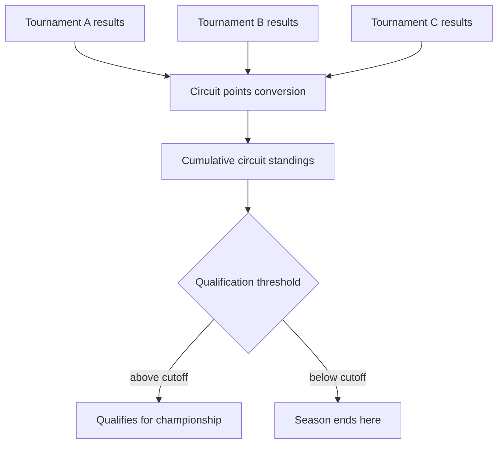

# Cross-Tournament Ecosystem: Circuits, Ratings & Identity Integrity

[04-identity-and-auth.md](04-identity-and-auth.md) covers how a person gets a persistent account and claims individual tournaments into it. This document covers what happens **once results start accumulating across many independently-run tournaments** — how a circuit's season standings work, how a speaker's cross-event competitiveness gets compared at all, and how the system keeps one person's record from becoming tangled with someone else's.

## 1. Circuits & series

A **circuit** (or series) is an organizer-defined group of tournaments whose results roll up into a season-long standing, distinct from any single tournament's own standings.

- A circuit is owned by a **Circuit Administrator** (see [03-roles-and-access.md](03-roles-and-access.md)), who is typically not the tab staff of every member tournament — a circuit is a season-long structure that individual tournament directors *opt their event into*, not something a circuit admin imposes on a tournament's internal operations.
- Each member tournament keeps running exactly as described in [01-tournament-mechanics.md](01-tournament-mechanics.md) — the circuit layer only reads *published* results (respecting the tournament's own publishing gates in [05-publishing-and-state.md](05-publishing-and-state.md)) and never reaches into a tournament's live operations.
- **Circuit points** are computed from each member tournament's final standings via an organizer-configured conversion table (e.g., "1st place = 100 circuit points, 2nd = 90, …" or a curve scaled by field size, since a win in a 60-speaker field should weigh more than a win in an 8-speaker field). This conversion is explicit and published, not a black-box formula.
- **Circuit standings** are the cumulative circuit points across all of a season's member tournaments, with the same drop-worst-result option as §7 of [01-tournament-mechanics.md](01-tournament-mechanics.md), applied at the circuit level (e.g., "best 6 of 8 tournaments count").
- **Circuit qualification thresholds** ("top N in circuit points qualify for the circuit championship / a national-level event") are just another break rule (§8, [01-tournament-mechanics.md](01-tournament-mechanics.md)) applied to circuit standings instead of a single tournament's standings — same mechanism, one level up.

A speaker/institution can belong to zero, one, or many circuits simultaneously — circuit membership is additive and doesn't affect how any individual tournament scores or publishes.

## 2. Cross-tournament rating & seeding

Raw rank or points from one tournament aren't directly comparable to another's — field size, competition strength, and judge pool all vary. For features that need a single comparable number across tournaments (seeding a speaker into seeded pools at a new event, circuit-independent power rankings, "who are the top speakers this season across all events"), PS Tab maintains an optional **cross-tournament rating**.

- The rating updates after each tournament a claimed account competes in, weighted by that tournament's field strength (itself a function of the average rating of the field) and the speaker's finish relative to that field — conceptually similar to an Elo/Glicko-style adjustment, not a simple points sum.
- This is deliberately **separate from circuit points** (§1): circuit points are a transparent, organizer-defined conversion table meant to be human-auditable; the cross-tournament rating is a statistical estimate meant for seeding/discovery, and is labeled as such wherever shown so nobody mistakes it for an official standing.
- Rating is **opt-in at the account level** — a claimed account can be excluded from rating computation entirely (relevant for privacy-conscious users or minors, §4) without affecting their circuit standings or tournament results, which are unaffected either way.
- New/unrated speakers (no claimed history yet) are seeded by tournament-local information only (e.g., prior-round performance within that same tournament) — a rating gap is never treated as a competitive penalty.

## 3. Institution-level aggregation ("sweepstakes")

Beyond individual results, many circuits track **institution-level standings** — an aggregate score representing how an entire school/club performed, both within one tournament and across a season.

- **Within a tournament:** an institution's sweepstakes score is computed from a configured rule over its speakers' individual results (common patterns: sum of the top-K speakers' points, or points-per-placement-bracket summed across all entrants) — configured per tournament, since conventions vary by circuit.
- **Across a circuit:** the same aggregation logic from §1 applies one level up — an institution's circuit standing is its cumulative sweepstakes score across member tournaments, with its own optional break/award threshold (e.g., a season sweepstakes trophy).
- Sweepstakes scoring never affects individual speaker standings or rank — it's a purely derived, parallel leaderboard.

## 4. Identity integrity: disambiguation, merging & disputes

Career aggregation only works if "this account" reliably means "this one person" across every tournament it claims. A few real failure modes need explicit handling, beyond the straightforward email-match/claim-code flow in [04-identity-and-auth.md](04-identity-and-auth.md):

- **Name collisions:** two different people with the same name at different tournaments. Claiming is always **email-anchored, never name-anchored** — a claim only succeeds against a specific roster entry's email or an explicit claim code, so a name match alone is never sufficient to attach a result to an account.
- **Duplicate accounts:** the same person accidentally creates two accounts (different emails, forgotten prior signup). Provide an explicit **account merge** flow: the person requests a merge, verifies ownership of both accounts (confirms access to both, e.g. via a login-and-confirm step on each), and the system combines claimed-tournament history into one account, retiring the other. Merges are logged, not silent, and reversible for a grace period in case the wrong pair gets merged.
- **Claim disputes:** two accounts both attempt to claim the same roster entry (e.g., a shared family email, or a genuine mistake). The system flags this as a **contested claim** rather than granting it to whichever request arrived first — resolution requires organizer/tab-staff confirmation of who the roster entry actually belongs to, since only the tournament that owns that roster data can authoritatively say.
- **Fraudulent claims:** someone claims a tournament result that isn't theirs to inflate a career record. Because claiming requires either an email match to that specific roster entry or a claim code the organizer controls, this is structurally hard to fake — but organizers retain a **claim audit view** per tournament (who claimed which roster entry, when) and the ability to revoke a wrongly-approved claim, with the affected account's aggregated stats recomputed immediately on revocation.

## 5. Minors, consent & data rights

Public speaking competitors skew younger than most platforms this pattern gets built for (many are secondary-school students), so this needs explicit design rather than being an afterthought:

- Roster entries can be flagged as a **minor** at import (age or grade-level field, organizer-provided). A minor's roster entry still gets a zero-auth token exactly as in [04-identity-and-auth.md](04-identity-and-auth.md) — tournament-day access is unaffected — but **creating a persistent authenticated account or opting into cross-tournament rating requires guardian consent**, gated the same way a claim is: an explicit, confirmable step, never automatic.
- A **Parent/Guardian viewer** role (added in [03-roles-and-access.md](03-roles-and-access.md)) can view a minor's own results/feedback without needing the minor's own token — scoped identically to the competitor's own private view, not broader.
- **Data deletion rights:** any account holder (or a guardian, for a minor) can request deletion of their persistent profile and its cross-tournament aggregation. Historical *tournament* records aren't deleted (a tournament's own results are that tournament's data of record, per [05-publishing-and-state.md](05-publishing-and-state.md)'s immutability principle) but the **link** between that history and the person's identity/account is removed — their claimed results revert to an unclaimed roster entry, and the account itself along with its aggregated view is deleted.
- **Retention period:** archived tournaments (§1, [05-publishing-and-state.md](05-publishing-and-state.md)) are retained indefinitely as historical record by default, but organizers/platform operators define a retention policy for how long *unclaimed* roster PII (emails on entries nobody ever claimed) is kept before being purged — unclaimed contact data has no ongoing purpose past a reasonable claim window, whereas the competitive result itself (rank, score) is retained as historical record without the contact-info tail attached.

## 6. Judge credential portability

A judge who reliably judges across a circuit builds a track record worth carrying between tournaments, not just within one:

- The **judge reliability metrics** introduced in [04-identity-and-auth.md](04-identity-and-auth.md) (panel-consensus alignment, on-time ballot submission) aggregate the same way career competitor stats do — visible to the judge on their own profile, and visible to tab staff of *any* tournament the judge is invited to (not just the one that generated the metric), so a new tournament's staff can make an informed invite/assignment decision without needing that judge's history relayed by word of mouth.
- Circuits (§1) may define **credential tiers** (e.g., novice/regional/certified judge) as an explicit organizer-assigned designation layered on top of the raw metrics — used for judge assignment eligibility (e.g., "chair must be a certified judge") the same way a rubric or break rule is an organizer configuration, not an automatically-computed label.
